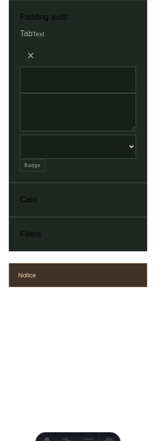
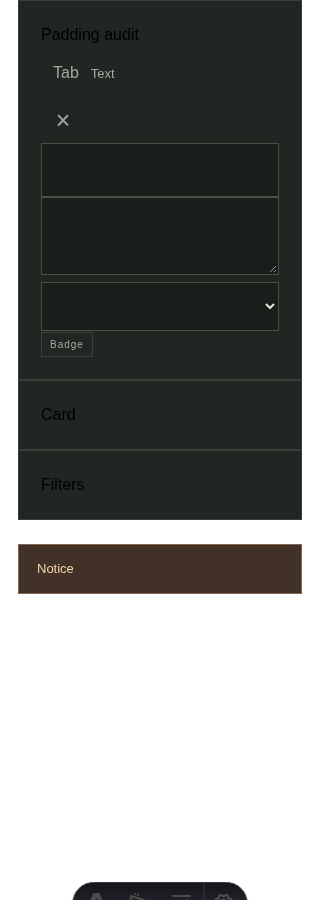
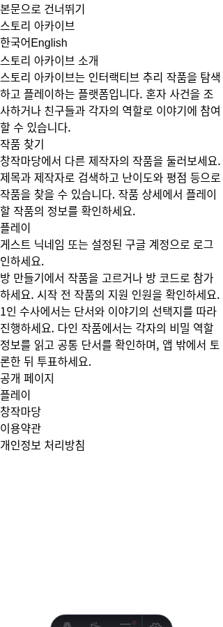
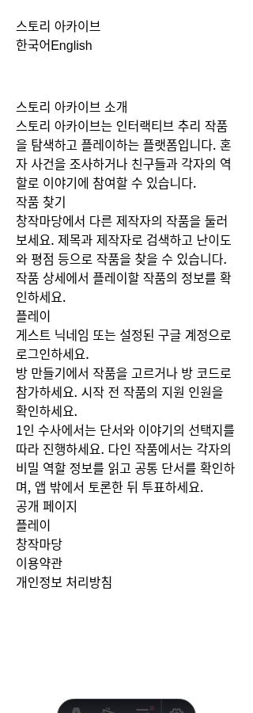

# #157 패딩 전수 조사

## 조사 기준

기준 dev: `48e9a1c`. `apps/web/src`의 Svelte 47개·Astro 19개(총 66개)를 정적 조사했다. `uno.config.ts`의 shortcut, 전역 `base.css`, DTCG spacing 및 호출부의 override도 함께 확인했다. 아래 표는 파일별 판단이며 모든 컴포넌트를 브라우저로 개별 실행했다는 의미는 아니다. 실제 계산 스타일·화면 검증은 공통 UI 픽스처와 대표 화면에서 수행했다.

패딩은 CSS 상속 속성이 아니다. 부모의 내부 여백, 공유 클래스와 반응형·호출부 override를 포함해 콘텐츠와 경계의 실제 간격을 판단했다. 이미지·아이콘·배치 래퍼·목록 초기화에는 일괄적으로 여백을 추가하지 않았다.

## 변경과 의도적인 무여백

- 공유 tab 버튼은 variant만 사용하면 계산 패딩이 `0px`이었다. 기본과 `.tab`에 spacing-3/3-5(좌우 12px·상하 14px)를 적용했다.
- 편집기 파일 입력과 네이티브 파일 선택 버튼에 spacing-2/3을 적용했다. 바깥 file-label의 기존 패딩과 구분해 클릭 요소 내부의 누락을 보완한다.
- 소개 페이지 header/main과 404 본문의 누락된 여백을 보완했다. 소개 페이지의 skip-link에 이미 존재하는 공통 스타일도 연결했다.
- 친구 목록, 법적 페이지, skip-link의 기존 패딩은 값 변경 없이 spacing 변수로 연결했다.
- 기존 shortcut에서 쓰이던 1.25·7.5·11.25·13.5 스케일을 DTCG에 명시했다. 값은 기존 quarter-rem 스케일과 동일하며 새 임의 픽셀 크기는 도입하지 않았다.
- 이미지 카드의 외곽 0, fieldset/list 초기화, inline 텍스트 링크의 수평 0, 중앙 정렬 dismiss의 수직 0은 유지했다. Card/Panel/Modal에 추가 padding wrapper를 만들지 않았다.

## 파일별 결과

| 소스 (`apps/web/src/` 기준) | 판단·조치 |
| --- | --- |
| `App.svelte` | 라우트·앱 조립·메타데이터. 위임한 레이아웃/컴포넌트가 여백 소유, wrapper에 중복 패딩 추가 안 함. |
| `app/App.svelte` | 라우트·앱 조립·메타데이터. 위임한 레이아웃/컴포넌트가 여백 소유, wrapper에 중복 패딩 추가 안 함. |
| `entities/member/ui/RoomMemberRow.svelte` | member 수직 패딩·부모 Panel 수평 패딩 유지. avatar는 고정 크기 중앙 정렬. |
| `entities/room/ui/RoomCard.svelte` | room-card p-6 / 모바일 panel p-5.5. 중첩 패딩 추가 안 함. |
| `entities/scenario/ui/ScenarioOption.svelte` | scenario 버튼 p-5.5 유지. |
| `features/account/NicknameField.svelte` | 부모 패널과 공통 입력·버튼이 패딩 소유. form/label에 추가 안 함. |
| `features/friends/FriendsDrawer.svelte` | Modal·Button 패딩 재사용. 제목 행·spacer는 배치만 담당하므로 패딩 추가 안 함. |
| `features/friends/FriendsPanel.svelte` | 목록 수직 패딩과 관련 간격을 기존 spacing 토큰으로 통일. 부모 Panel/Modal의 수평 여백 유지. |
| `features/game/SoloGame.svelte` | 각 카드·단서·장면·평점 버튼의 기존 토큰 유틸리티 패딩 유지. 본문·grid 래퍼는 중복 패딩 없음. |
| `features/game/SoloRoomLifecycle.svelte` | 수명 주기와 children만 담당. 레이아웃 패딩 없음. |
| `features/game/StoryCuePlayer.svelte` | 각 카드·단서·장면·평점 버튼의 기존 토큰 유틸리티 패딩 유지. 본문·grid 래퍼는 중복 패딩 없음. |
| `features/game/StoryRating.svelte` | 각 카드·단서·장면·평점 버튼의 기존 토큰 유틸리티 패딩 유지. 본문·grid 래퍼는 중복 패딩 없음. |
| `features/guest-login/ui/GuestLoginForm.svelte` | 부모 패널과 공통 입력·버튼이 패딩 소유. form/label에 추가 안 함. |
| `features/room-join/ui/JoinRoomForm.svelte` | 부모 패널과 공통 입력·버튼이 패딩 소유. form/label에 추가 안 함. |
| `layouts/AboutLayout.astro` | header/main 패딩 누락 보완, skip-link 공통 스타일 적용. |
| `layouts/AppLayout.astro` | 라우트·앱 조립·메타데이터. 위임한 레이아웃/컴포넌트가 여백 소유, wrapper에 중복 패딩 추가 안 함. |
| `layouts/LegalLayout.astro` | 기존 shell/header/footer/main 패딩을 동일 크기 spacing 변수로 교체. |
| `pages/404.astro` | shell 수평 패딩은 유지하고 본문 상하 spacing-8 보완. |
| `pages/about.astro` | 라우트·앱 조립·메타데이터. 위임한 레이아웃/컴포넌트가 여백 소유, wrapper에 중복 패딩 추가 안 함. |
| `pages/account/_MyPage.svelte` | shell/main과 Panel·입력·버튼·개별 컨테이너가 패딩 소유. 목록·진행 단계 p-0은 의도적. |
| `pages/account/_NicknameSetup.svelte` | shell/main과 Panel·입력·버튼·개별 컨테이너가 패딩 소유. 목록·진행 단계 p-0은 의도적. |
| `pages/en/about.astro` | 라우트·앱 조립·메타데이터. 위임한 레이아웃/컴포넌트가 여백 소유, wrapper에 중복 패딩 추가 안 함. |
| `pages/en/index.astro` | 라우트·앱 조립·메타데이터. 위임한 레이아웃/컴포넌트가 여백 소유, wrapper에 중복 패딩 추가 안 함. |
| `pages/en/mypage.astro` | 라우트·앱 조립·메타데이터. 위임한 레이아웃/컴포넌트가 여백 소유, wrapper에 중복 패딩 추가 안 함. |
| `pages/en/privacy.astro` | 라우트·앱 조립·메타데이터. 위임한 레이아웃/컴포넌트가 여백 소유, wrapper에 중복 패딩 추가 안 함. |
| `pages/en/terms.astro` | 라우트·앱 조립·메타데이터. 위임한 레이아웃/컴포넌트가 여백 소유, wrapper에 중복 패딩 추가 안 함. |
| `pages/en/workshop/editor.astro` | 라우트·앱 조립·메타데이터. 위임한 레이아웃/컴포넌트가 여백 소유, wrapper에 중복 패딩 추가 안 함. |
| `pages/en/workshop.astro` | 라우트·앱 조립·메타데이터. 위임한 레이아웃/컴포넌트가 여백 소유, wrapper에 중복 패딩 추가 안 함. |
| `pages/entry/ui/EntryPage.svelte` | shell/main과 Panel·입력·버튼·개별 컨테이너가 패딩 소유. 목록·진행 단계 p-0은 의도적. |
| `pages/game/ui/GamePage.svelte` | shell/main과 Panel·입력·버튼·개별 컨테이너가 패딩 소유. 목록·진행 단계 p-0은 의도적. |
| `pages/index.astro` | 라우트·앱 조립·메타데이터. 위임한 레이아웃/컴포넌트가 여백 소유, wrapper에 중복 패딩 추가 안 함. |
| `pages/lobby/ui/LobbyPage.svelte` | shell/main과 Panel·입력·버튼·개별 컨테이너가 패딩 소유. 목록·진행 단계 p-0은 의도적. |
| `pages/mypage.astro` | 라우트·앱 조립·메타데이터. 위임한 레이아웃/컴포넌트가 여백 소유, wrapper에 중복 패딩 추가 안 함. |
| `pages/privacy.astro` | 라우트·앱 조립·메타데이터. 위임한 레이아웃/컴포넌트가 여백 소유, wrapper에 중복 패딩 추가 안 함. |
| `pages/room/ui/RoomPage.svelte` | shell/main과 Panel·입력·버튼·개별 컨테이너가 패딩 소유. 목록·진행 단계 p-0은 의도적. |
| `pages/terms.astro` | 라우트·앱 조립·메타데이터. 위임한 레이아웃/컴포넌트가 여백 소유, wrapper에 중복 패딩 추가 안 함. |
| `pages/workshop/editor.astro` | 라우트·앱 조립·메타데이터. 위임한 레이아웃/컴포넌트가 여백 소유, wrapper에 중복 패딩 추가 안 함. |
| `pages/workshop/ui/StoryFields.svelte` | fieldset padding:0은 이중 여백 방지. scene spacing-4, 공통 입력·버튼 패딩 유지. |
| `pages/workshop/ui/WorkshopEditor.svelte` | 파일 input·네이티브 선택 버튼에 spacing-2/3 적용. file-label은 기존 spacing-6, checkbox 무여백 유지. |
| `pages/workshop/ui/WorkshopPage.svelte` | story-card padding:0은 의도적. card-content spacing-5, 필터·통계·상세·즐겨찾기 패딩 정상. |
| `pages/workshop.astro` | 라우트·앱 조립·메타데이터. 위임한 레이아웃/컴포넌트가 여백 소유, wrapper에 중복 패딩 추가 안 함. |
| `shared/seo/Metadata.astro` | 라우트·앱 조립·메타데이터. 위임한 레이아웃/컴포넌트가 여백 소유, wrapper에 중복 패딩 추가 안 함. |
| `shared/ui/Badge.svelte` | tag 패딩 유지. |
| `shared/ui/Button.svelte` | tab 기본 패딩 보완. primary/secondary/scenario 정상, text는 수평 0·dismiss는 수직 0과 최소 터치 크기 의도 유지. |
| `shared/ui/CallToAction.svelte` | primary/secondary 재사용. |
| `shared/ui/Card.svelte` | panel 패딩. 전체 이미지 카드는 호출부에서 외곽 0, 내용부에서 패딩 적용. |
| `shared/ui/FilterBar.svelte` | panel 패딩과 grid gap 유지. |
| `shared/ui/LazyContent.svelte` | 임베디드 상태는 부모 Panel/Modal, 독립 상태는 main이 여백 소유. |
| `shared/ui/ManagedImage.svelte` | 이미지와 대체 심벌은 부모가 크기·여백 소유. 무여백 유지. |
| `shared/ui/Modal.svelte` | modal 패딩 36px / 모바일 22px 유지. |
| `shared/ui/Offcanvas.svelte` | Modal 재사용. 추가 패딩 없이 중복 방지. |
| `shared/ui/PageState.svelte` | StateMessage가 내용 여백 소유. |
| `shared/ui/Panel.svelte` | panel 패딩 28px / 모바일 22px 유지. |
| `shared/ui/Select.svelte` | input-field 재사용. |
| `shared/ui/Skeleton.svelte` | 장식 상자. 무여백 유지. |
| `shared/ui/Spinner.svelte` | 고정 크기 장식과 label gap. 패딩 추가 안 함. |
| `shared/ui/StateMessage.svelte` | empty 패딩 유지. |
| `shared/ui/Text.svelte` | 텍스트 자체 패딩 없음. 부모와 행간이 여백 소유. |
| `shared/ui/TextArea.svelte` | input-field 재사용. |
| `shared/ui/TextInput.svelte` | input-field 패딩 14px 16px 유지. |
| `shared/ui/Toast.svelte` | notice 패딩 14px 18px 유지. |
| `widgets/app-footer/ui/AppFooter.svelte` | header/footer 수직·shell 수평 패딩 유지. inline 링크·identity에는 중복 패딩 없음. |
| `widgets/app-footer/ui/LegalLinks.svelte` | header/footer 수직·shell 수평 패딩 유지. inline 링크·identity에는 중복 패딩 없음. |
| `widgets/app-header/ui/AppHeader.svelte` | header/footer 수직·shell 수평 패딩 유지. inline 링크·identity에는 중복 패딩 없음. |
| `widgets/error-notice/ui/ErrorNotice.svelte` | Toast 재사용. |
| `widgets/story-picker/ui/StoryPickerDialog.svelte` | 외곽 카드 무여백으로 썸네일을 끝까지 표시, 내용부 p-4 유지. 필터 spacing-4, Modal 패딩 재사용. |

## 실제 검증

- 임시 UI 픽스처의 수정 전/후 계산값: tab `0px` → `14px 12px`. Panel/Card/FilterBar는 desktop `28px`, mobile `22px`; input/textarea/select는 `14px 16px`; Toast는 `14px 18px`; Modal은 desktop `36px`, mobile `22px`로 정상 유지.
- 편집기·친구 목록을 임시 픽스처에서 렌더링: 파일 입력 `8px`, 파일 선택 버튼 `8px 12px`; 긴 닉네임과 받은 요청 버튼을 포함한 320/1280px 가로 넘침 없음. 친구 목록 응답만 레이아웃 검증용으로 모킹했으며 인증·관계 저장 검증으로 간주하지 않는다.
- Chromium: ko/en × 320/1280px에서 홈·창작마당·소개·약관·개인정보·404의 가로 넘침 없음. 게스트 로그인 → 방 만들기 → 작품 선택 → 필터 열기·검색·접기·재열기 시 입력 유지 → Escape 닫기 통과, pageerror 0.
- `bash scripts/codex/verify.sh --browser`: check/build 및 101 tests / 5,277 assertions 통과. 마지막 단계는 저장소에 `test:e2e`가 없어 exit 1. 위 별도 Chromium 증거로 보완하며 자동 E2E 통과로 기록하지 않는다.
- 위 검증용 픽스처는 제거했으며 제품 경로·번들에 포함하지 않는다. 개발·브라우저 검증은 메모리 DB만 사용했다. 전체 게임 단계·실기기·다른 브라우저의 시각 검증은 수행하지 않았다.

### 수정 전후 화면 (320px)

공통 UI 픽스처:

소개 페이지:

