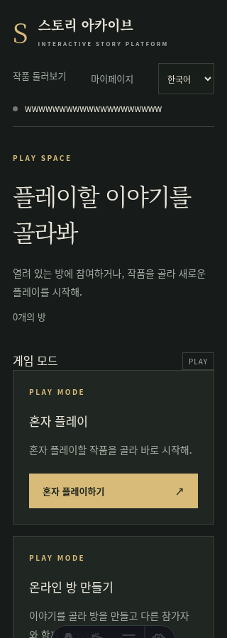
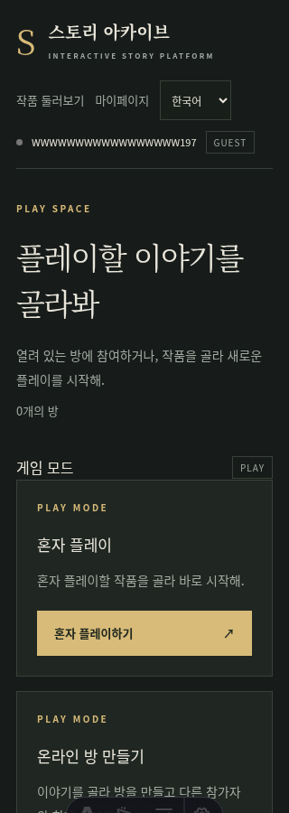
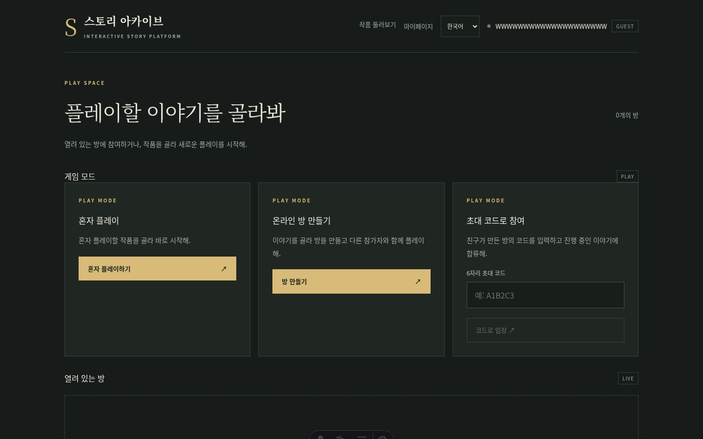
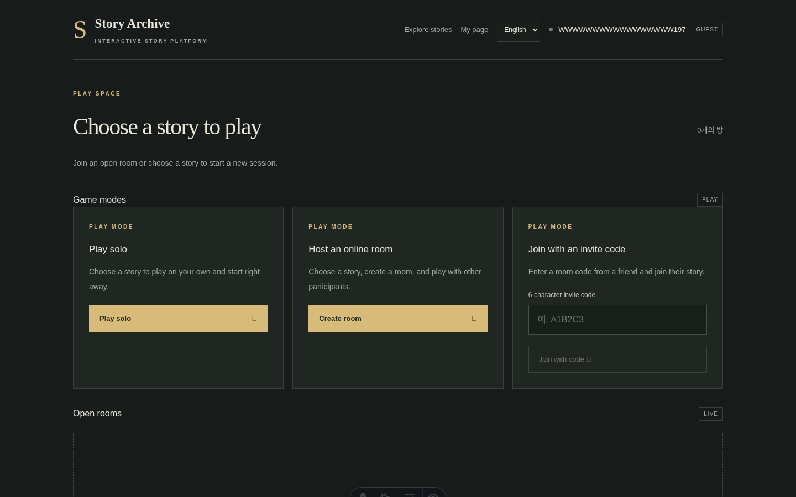

# 상단 내비게이션 검증 (#97)

실제 headless Chromium에서 변경 전 dev `15b51a1`와 변경 후 UI를 확인했다.
게스트 로그인 후 최대 길이 영문 닉네임(20자)을 사용했다.
한국어·영어 각각 320, 375, 640, 768, 1024, 1440px에서 전체 문서 가로 넘침이 없고,
링크·언어 선택·상태 점·닉네임·계정 배지가 화면 안에 있으며 사용자 요소의 수직 중심이 일치함을 확인했다.
언어 변경과 창작마당 링크 이동도 확인했다.

| 화면 | 변경 전 | 변경 후 |
| --- | --- | --- |
| 모바일 320px |  |  |
| 데스크톱 1440px |  |  |

`.identity`의 `display:flex`와 `align-items:center`는 `apps/web/uno.config.ts`의
`identity` shortcut에서 제공한다. 닉네임 span은 flex item이므로 blockify되며,
`min-width:0`·`overflow:hidden`·`text-overflow:ellipsis`가 적용된다.
`base.css`의 공통 flex-wrap 규칙은 AppHeader의 scoped `.identity { flex-wrap: nowrap }`로 덮어쓴다.

`bash scripts/codex/verify.sh --browser`에서 check/build/47개 테스트가 통과했다.
자동 test:e2e 명령은 없으므로 wrapper는 예상대로 exit 1을 반환했으며,
이 문서의 실제 브라우저 근거로 보완했다. 통과하지 않은 명령을 통과로 표시하지 않는다.
